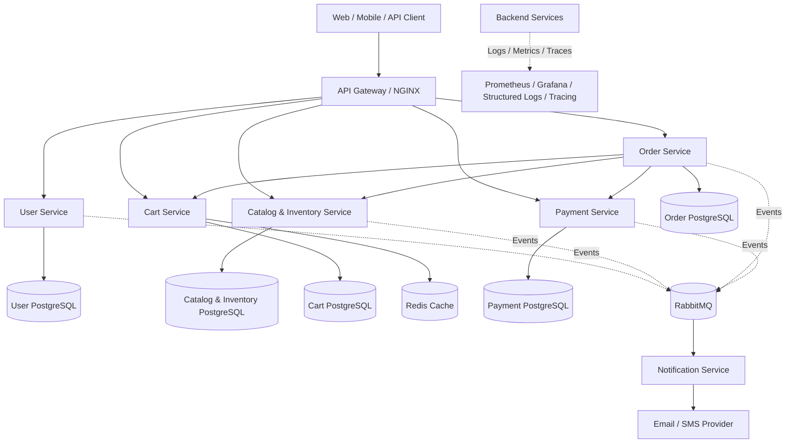

# Architecture

## 1. Goals

Build an e-commerce backend that demonstrates:

- Clear microservice boundaries and data ownership.
- Reliable inter-service communication.
- Data consistency and concurrency control.
- Inventory reservation and payment workflows.
- Fault recovery and idempotent operations.
- Observability through logs, metrics, and tracing.
- Independent service development and deployment.

The architecture should evolve incrementally. Prioritize a working end-to-end MVP before introducing additional infrastructure.

## 2. High-Level Architecture

The following diagram represents the proposed target architecture, not the current implementation status.



This is a logical architecture. During local development, a single PostgreSQL server can host separate databases or schemas for multiple services.

However, each service must access only the data it owns. Other services must communicate through APIs or events rather than directly accessing its tables.

## 3. Service Responsibilities

| Service | Responsibilities |
|---|---|
| User | Registration, authentication, authorization, profile management |
| Catalog & Inventory | Product management, categories, pricing, stock management, inventory reservations |
| Cart | Adding, updating, retrieving, and removing cart items |
| Order | Checkout orchestration, order creation, order item snapshots, order status, order history |
| Payment | Payment attempts, payment provider integration, webhook verification, payment status |
| Notification | Email/SMS notifications and delivery retry tracking |
| API Gateway | Request routing, TLS termination, rate limiting, request-size limits |

### Important ownership rules

- User Service owns user information and authentication.
- Catalog Service owns product information and inventory.
- Cart Service owns cart items and quantities.
- Order Service owns orders and order item snapshots.
- Payment Service owns payment attempts and payment records.
- Notification Service owns notification delivery records.

For a solo project, combining Catalog and Inventory is reasonable. Keep their domain logic separated internally so they can be split later if necessary.

## 4. Communication Patterns

### 4.1 Synchronous HTTP

Use HTTP for operations that require an immediate response.

Examples:

- Retrieving product details.
- Adding, updating, and removing cart items.
- Retrieving cart contents.
- Requesting checkout.
- Fetching order status.
- Validating product availability during checkout.

Example checkout communication:

```text
Client
  |
  v
Order Service
  |
  +----> Cart Service
  |        |
  |        +----> Cart Items
  |
  +----> Catalog Service
  |        |
  |        +----> Product Details / Inventory
  |
  +----> Payment Service
```

The Order Service coordinates checkout but does not directly access another service's database.

### 4.2 Asynchronous Events

Introduce a message broker such as RabbitMQ for operations that can happen independently of the original HTTP request.

Proposed events:

| Event | Purpose |
|---|---|
| OrderCreated | An order has been created |
| InventoryReserved | Stock has been successfully reserved |
| InventoryReservationFailed | Stock reservation failed |
| PaymentSucceeded | Payment was successful |
| PaymentFailed | Payment failed |
| OrderConfirmed | Order has been confirmed |
| OrderCancelled | Order has been cancelled |
| InventoryReleased | Reserved stock has been released |
| NotificationRequested | A notification needs to be delivered |

Define event schemas, event IDs, timestamps, and versions.

Consumers must tolerate duplicate delivery and process events idempotently.

Do not introduce RabbitMQ until the synchronous MVP is working. Add asynchronous communication when it provides a clear benefit.

## 5. Infrastructure

| Component | Initial Choice | Purpose |
|---|---|---|
| Backend | Go with Gin / net/http | HTTP APIs and background workers |
| Database | PostgreSQL | Durable relational storage and transactions |
| Cache | Redis | Caching and temporary data |
| Message Broker | RabbitMQ | Asynchronous messaging |
| API Gateway | NGINX | Reverse proxy and routing |
| Local Orchestration | Docker Compose | Repeatable local environment |
| Metrics | Prometheus + Grafana | Service and runtime metrics |
| Logging | Structured JSON logs | Debugging and monitoring |
| CI | GitHub Actions | Automated tests and builds |

### Infrastructure decisions

- PostgreSQL is the primary persistent data store.
- Redis should not replace PostgreSQL as the source of truth for durable business data.
- Docker Compose service-name networking is sufficient for local development.
- Kubernetes and dedicated service discovery are not initial requirements.
- Introduce infrastructure components only when the application needs them.

## 6. Reliability Patterns

### Idempotency

Repeated client requests must not create duplicate orders or payment attempts.

Use idempotency keys for operations where duplicate execution would cause problems.

### Transactional Outbox

When asynchronous messaging is introduced, persist business state and the corresponding event record within the same local database transaction.

A separate publisher reads pending outbox records and publishes them to RabbitMQ.

### Consumer Deduplication

Consumers should track processed event IDs and prevent duplicate business operations.

### Saga Pattern

Checkout involves multiple independent services and cannot rely on one distributed database transaction.

Use an explicit order state machine and compensating actions.

For example:

- If inventory reservation fails, cancel checkout.
- If payment fails, release reserved inventory.
- If payment succeeds, confirm the order.
- If an order expires before payment, release its inventory reservation.

### Timeouts

Set explicit timeouts for inter-service HTTP calls and external payment-provider requests.

### Retries

Retry only transient failures using bounded exponential backoff and jitter.

Do not blindly retry operations that might create duplicate payments or orders.

### Observability

Implement:

- Structured JSON logging.
- Request and correlation IDs.
- HTTP request latency and error metrics.
- Database connection and query monitoring.
- Background worker metrics.
- Distributed tracing when service communication grows.

## 7. Architecture Constraints

- Never store raw card details.
- Verify payment-provider webhook signatures.
- Keep secrets outside source control.
- Store monetary values using integer minor units (paise for INR).
- Never trust product prices or order totals supplied by the client.
- Calculate prices using Catalog Service data.
- Reserve inventory using atomic database operations.
- Do not allow one service to access another service's database directly.
- Do not claim scalability or reliability without supporting test results.

## 8. Proposed Project Structure

```text
ecommerce-platform/
├── services/
│   ├── user/
│   ├── catalog/
│   │   ├── cmd/
│   │   │   └── api/
│   │   │       └── main.go
│   │   ├── internal/
│   │   │   ├── product/
│   │   │   │   ├── model.go
│   │   │   │   ├── handler.go
│   │   │   │   ├── service.go
│   │   │   │   ├── repository.go
│   │   │   │   └── repository_test.go
│   │   │   ├── inventory/
│   │   │   ├── http/
│   │   │   ├── config/
│   │   │   └── database/
│   │   ├── migrations/
│   │   ├── Dockerfile
│   │   ├── go.mod
│   │   └── README.md
│   ├── cart/
│   ├── order/
│   ├── payment/
│   └── notification/
│
├── gateway/
│   └── nginx.conf
│
├── deployments/
│   ├── docker-compose.yml
│   └── prometheus/
│       └── prometheus.yml
│
├── tests/
│   ├── integration/
│   ├── e2e/
│   └── load/
│
├── docs/
│   ├── README.md
│   ├── architecture.md
│   ├── checkout-workflow.md
│   ├── service-workflows.md
│   ├── failure-recovery.md
│   ├── data-ownership.md
│   ├── development-roadmap.md
│   └── testing-and-scalability.md
│
├── .github/
│   └── workflows/
│       └── ci.yml
├── .gitignore
└── README.md
```

## 9. Catalog Service Internal Structure

The Catalog Service contains product management and inventory management logic.

| File / Directory | Responsibility |
|---|---|
| cmd/api/main.go | Application entry point and dependency initialization |
| internal/product/model.go | Product domain structures |
| internal/product/handler.go | HTTP request handling and response formatting |
| internal/product/service.go | Product business logic and validation |
| internal/product/repository.go | Product database operations |
| internal/product/repository_test.go | Product repository tests |
| internal/inventory/ | Stock management and reservation logic |
| internal/config/ | Environment-based configuration |
| internal/database/ | Database connection and initialization |
| migrations/ | Versioned database schema changes |
| Dockerfile | Builds the service container |
| go.mod | Go module dependencies |

Keep product and inventory responsibilities separate even if they share the same database initially.

## 10. Implementation Phases

### Phase 1: Catalog Service

```text
services/
└── catalog/
    ├── cmd/
    │   └── api/
    ├── internal/
    │   ├── product/
    │   ├── config/
    │   └── database/
    ├── migrations/
    ├── Dockerfile
    ├── go.mod
    └── README.md
```

Initial goals:

- Product CRUD operations.
- Category management.
- Product listing and pagination.
- Product filtering.
- PostgreSQL integration.
- Unit and integration tests.

### Phase 2: Core E-Commerce Services

- User Service.
- Cart Service.
- Catalog and Inventory integration.
- Order Service.
- Checkout workflow.

### Phase 3: Payment and Reliability

- Payment Service.
- Payment-provider integration.
- Inventory reservation and release.
- Order expiration worker.
- Idempotency and failure recovery.

### Phase 4: Asynchronous Processing

- RabbitMQ integration.
- Transactional outbox.
- Event consumers.
- Notification Service.

### Phase 5: Observability and Scalability

- Structured logging.
- Prometheus metrics.
- Grafana dashboards.
- Integration and end-to-end testing.
- Concurrency testing.
- Load testing and performance optimization.

---

**Note:** This document describes the intended architecture. Features and infrastructure should be marked as implemented only after they exist and have been tested in the actual project.