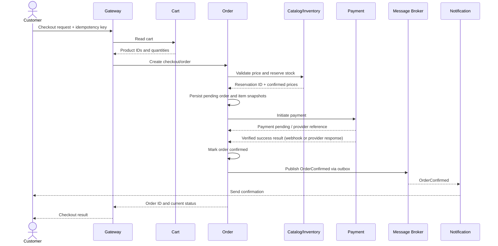

# Checkout Workflow

## 1. Objective

Place an order without overselling inventory, charging the customer more than once, or leaving the order permanently inconsistent after a temporary failure.

## 2. Successful checkout

Implementation details can vary. In particular, payment providers may complete asynchronously, so checkout should be able to return a `pending_payment` state and let the client poll the order status.

## 3. Recommended state transitions

### Order states

`pending` → `awaiting_payment` → `confirmed`

Failure paths:

- `pending` → `cancelled`
- `awaiting_payment` → `payment_failed`
- `awaiting_payment` → `cancelled` after an allowed timeout/compensation policy
- `payment_failed` → a new payment attempt, if the product policy permits it

Do not allow arbitrary state changes. Validate each transition and make updates conditional on the current state.

### Inventory reservation states

`reserved` → `committed`

or

`reserved` → `released`

A reservation should have an expiry time. A background worker can release expired reservations, but it must check the current state so it cannot release already committed stock.

### Payment states

`created` → `pending` → `succeeded`

or

`created` / `pending` → `failed`

A timeout does not prove that a payment failed. Query the provider or wait for a verified webhook before deciding whether to retry or compensate.

## 4. Inventory reservation rules

- Reserve stock atomically in a database transaction.
- Ensure available stock cannot become negative.
- Do not rely on a read-then-write sequence without concurrency control.
- Give each reservation a unique ID and associate it with the order.
- Release stock only once.
- Use a reservation expiry/recovery worker for abandoned checkouts.

## 5. Payment rules

- Generate a stable idempotency key for each logical payment attempt.
- Persist the attempt before or as part of initiating provider work.
- Verify webhook signatures and deduplicate webhook event IDs.
- Never interpret an unknown payment outcome as definite failure.
- Never store card numbers or security codes.
- Keep payment state separate from order state; the Order Service consumes payment outcomes and applies valid order transitions.

## 6. Failure paths

| Failure | Expected handling |
|---|---|
| Cart is empty or invalid | Reject checkout |
| Product no longer exists | Reject or require cart update |
| Price changed | Recalculate using trusted data and return updated total for confirmation if needed |
| Insufficient stock | Do not initiate payment |
| Payment definitively fails | Mark attempt failed and release reservation |
| Payment times out | Keep outcome pending; reconcile with provider |
| Duplicate checkout request | Return the existing order for the same idempotency key |
| Duplicate success webhook | Deduplicate; do not confirm or charge twice |
| Notification provider is down | Retry notification asynchronously; do not roll back a paid order |
| Service crashes after database commit | Recover pending outbox records and resume processing |

## 7. Saga and outbox

Checkout spans multiple services, so do not attempt one transaction across their databases.

Use a Saga-style workflow with explicit states and compensating actions. For reliable event publication, write the order change and an outbox record in the same database transaction. A publisher sends pending outbox records to RabbitMQ and marks them as published. Consumers must still be idempotent because duplicate delivery is possible.

## 8. Client response

Return a stable order ID and an explicit status. The client should retrieve current status through an order-status endpoint rather than assuming a successful HTTP response means payment and fulfillment have completed.

